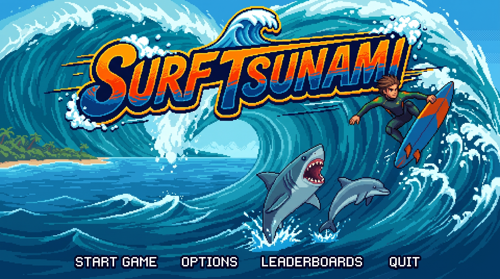

# 🌊 Surf Tsunami 2D

> **Surf Tsunami 2D** es un juego *endless runner* de surf en 2D desarrollado con **Unity 6** y **C#**.
> Surfea sobre una ola gigante esquivando criaturas marinas, salta en la copa de la ola,
> recoge tablas de bonus y consigue la mejor puntuación.



---

## 📋 Índice

1. [¿De qué trata el juego?](#-de-qué-trata-el-juego)
2. [Características principales](#-características-principales)
3. [Cómo jugar (controles)](#-cómo-jugar-controles)
4. [Cómo funciona el juego (mecánicas)](#-cómo-funciona-el-juego-mecánicas)
5. [Escenas del juego](#-escenas-del-juego)
6. [Personajes y elementos](#-personajes-y-elementos)
7. [Estructura del proyecto](#-estructura-del-proyecto)
8. [Recursos (Assets)](#-recursos-assets)
9. [Historia del desarrollo](#-historia-del-desarrollo)
10. [Cómo abrir y ejecutar](#-cómo-abrir-y-ejecutar)
11. [Compilar para móvil](#-compilar-para-móvil)
12. [Personalización](#-personalización)
13. [Documentación técnica](#-documentación-técnica)

---

## 🏄 ¿De qué trata el juego?

Un surfista cabalga sobre la cresta de una ola gigante en alta mar. El escenario avanza
(parallax) y por delante aparecen **criaturas marinas** que hay que esquivar:

- 🐙 **Pulpo**
- 🦈 **Tiburón**
- 🐬 **Delfín** (se acerca nadando)
- 🏊 **Bañista**

Si chocas contra una criatura pierdes una de tus **3 vidas** (representadas como tablas de
surf en el HUD). Mientras tanto, ir **esquivando** a las criaturas suma puntos, y también
puedes recoger **tablas de surf de bonus** que dan puntos extra. Llega lo más lejos que
puedas, consigue el mayor puntaje y deja tu marca en el **ranking (Leaderboards)**.

El juego está pensado para jugarse en **horizontal** y funciona con **teclado, mando de
consola y pantalla táctil (móvil/tablet)**.

---

## ✨ Características principales

- 🎮 **Controles duales**: teclado + mando (Input System nuevo) y controles táctiles
  (joystick flotante + botón de salto) que aparecen solos en móvil.
- 🏄 **Físicas de surfista sin gravedad**: flota sobre la ola, nunca se cae y no sale
  del encuadre de la cámara.
- 🤸 **Salto con truco aéreo**: salta automáticamente al llegar a la copa de la ola
  subiendo, o manualmente con Espacio / botón sur / toque en pantalla. Gira 360° en el aire.
- ❤️ **Sistema de vidas e invulnerabilidad**: 3 vidas, parpadeo invulnerable tras un golpe
  y animación de caída al perder.
- 🖼️ **Animación por fotogramas sin Animator**: los sprites se cargan solos desde
  `Assets/Resources` y se reescalan automáticamente a un tamaño coherente.
- 🎵 **Música generada por código** (chiptune playero en bucle) con soporte para un archivo
  de audio propio, y jingle cómico de "perdiste".
- 📊 **HUD con arte propio**: vidas como tablas de surf, marcador de puntaje y cartel de
  Game Over usando las imágenes de `Assets/Sprites/mensajes`.
- 🏆 **Ranking persistente**: se guardan los 5 mejores puntajes en `PlayerPrefs`.
- 🌅 **Parallax multicapa**: cielo, islas, ola, mar y sol en movimiento con bucle continuo.
- 📱 **Compilación móvil lista**: orientación horizontal, Canvas escalable y toques táctiles.

---

## 🎮 Cómo jugar (controles)

### Teclado (PC)

| Acción | Tecla |
|---|---|
| Moverse | `W A S D` o flechas |
| Saltar | `Espacio` |
| Reiniciar partida (en Game Over) | `R` |
| Volver al menú (en Game Over) | `Esc` o `M` |
| Mostrar/ocultar controles táctiles (prueba) | `T` |

### Mando (gamepad)

| Acción | Control |
|---|---|
| Moverse | Stick izquierdo o cruceta |
| Saltar | Botón sur (A / Cruz) |
| Volver (menú/paneles) | Botón este (B / Círculo) |

### Móvil / táctil

- **Joystick flotante**: toca en la **mitad izquierda** de la pantalla (donde te resulte
  cómodo) y arrastra para moverte. Suelta para detenerte.
- **Salto**: botón **SALTO** abajo a la derecha, o toca en cualquier punto de la
  **mitad derecha** de la pantalla.
- Movimiento y salto funcionan a la vez (multitáctil).
- En **Game Over** aparecen botones **REINTENTAR** y **MENÚ** (no hay tecla R en móvil).

> 💡 En el editor también puedes probar los controles táctiles activando
> `Mostrar En Escritorio` en el componente **ControladorTactil**, o pulsando **T** durante
> el Play.

---

## ⚙️ Cómo funciona el juego (mecánicas)

### Vidas

- Empiezas con **3 vidas** (3 tablas de surf en el HUD).
- Chocar con una criatura marina te resta **1 vida**.
- Tras un golpe quedas **invulnerable ~1,5 s** (el surfista parpadea) para no perder
  varias vidas seguidas.
- Chocar **mientras saltas** no hace daño.
- Al quedarte sin vidas: **Game Over**.

### Puntaje

| Acción | Puntos |
|---|---|
| Esquivar una criatura | **+100** |
| Recoger una tabla de bonus | **+250** |

- El puntaje se muestra en el HUD y se guarda en el ranking de la portada al terminar
  la partida.

### Salto

- **Automático**: al llegar a la copa de la ola mientras subes (`maxY`).
- **Manual**: con Espacio, botón sur del mando o toque en pantalla.
- Durante el salto el surfista hace una **trayectoria parabólica con giro de 360°** y, al
  aterrizar, vuelve a la cresta.

### Los obstáculos (criaturas)

- Se desplazan de **derecha a izquierda** a velocidades distintas según la criatura.
- **Ondulan** en el agua (efecto ola/nado) con amplitudes y frecuencias propias.
- Al salir por la izquierda **reaparecen a la derecha** en una posición aleatoria.
- Sus **colisionadores se ajustan al sprite visible** (factor 0.7) para que no quiten vidas
  "a distancia".

### Game Over

- Pantalla a pantalla completa con el cartel **GAME OVER**, tu **puntaje final** y la pista
  para reiniciar.
- La música cambia al **jingle cómico de "perdiste"**.
- Guarda el puntaje en el ranking y permite **Reiniciar (R)** o **Volver al menú (Esc/M)**.

---

## 🗺️ Escenas del juego

Las dos escenas están registradas en `File > Build Settings`:

| Escena | Archivo | Qué contiene |
|---|---|---|
| **Portada / Menú** | `Assets/Scenes/Inicio.unity` | Fondo con la portada dibujada y menú funcional: **START GAME**, **OPTIONS**, **LEADERBOARDS** y **QUIT** (zonas clicables sobre el arte). |
| **Juego** | `Assets/Scenes/SampleScene.unity` | La ola, el surfista, las criaturas marinas, las tablas de bonus, el parallax y el HUD. |

### Menú de la portada

El script `MenuInicio` crea zonas clicables invisibles sobre las palabras dibujadas en
`portada.jpg`:

- **START GAME** → carga la escena del juego.
- **OPTIONS** → panel con **SONIDO ON/OFF**, **MÚSICA ON/OFF**, **PANTALLA COMPLETA** y
  **BORRAR PUNTAJES**.
- **LEADERBOARDS** → los 5 mejores puntajes guardados.
- **QUIT** → cierra el juego (en el editor detiene la reproducción).

Navegación: ratón/táctil, flechas + Enter, o mando.

---

## 🐬 Personajes y elementos

| Elemento | Descripción |
|---|---|
| 🏄 **Surfista1** | El jugador. Flota sobre la ola, se mueve en 4 direcciones, salta y hace trucos. |
| 🐙 **Pulpo** | Obstáculo lento con 6 fotogramas de animación y gran ondulación. |
| 🦈 **Tiburón** | El más veloz (4,2). 4 fotogramas de nado. |
| 🐬 **Delfín** | Se acerca nadando con 6 fotogramas; ondula más que los demás. |
| 🏊 **Bañista** | Obstáculo lento y de poco bote, con 8 fotogramas. |
| 🏄 **Tablas de bonus** | Objetos que suman +250 puntos al recogerlos y reaparecen a la derecha. |
| 🖼️ **Fondo (parallax)** | Cielo, sol, islas, ola y mar que se mueven a distintas velocidades en bucle. |
| 📊 **HUD** | Vidas (tablas de surf), puntaje y cartel de Game Over. |

---

## 🗂️ Estructura del proyecto

```
SurfTsunami2D/
├── Assets/                          # Todo el contenido del juego
│   ├── Scenes/                      # Inicio.unity (menú) y SampleScene.unity (juego)
│   ├── Scripts (raíz de Assets)     # Todos los componentes en C#
│   ├── Resources/                   # Fotogramas y audio (se cargan solos)
│   │   ├── Surfista1/Surf           # 20 fotogramas del surf
│   │   ├── Surfista1/Caida          # Animación de caída (game over)
│   │   ├── Pulpo / Delfin / Tiburon / Banista   # Fotogramas de las criaturas
│   ├── Sprites/                     # Arte original (fondos, criaturas, mensajes, bonus)
│   ├── Settings/                    # URP 2D, Input System, plantillas
│   └── Welcome/                     # Plantilla 2D de Unity
├── Packages/                        # Manifiesto de paquetes de Unity
├── ProjectSettings/                 # Configuración del proyecto (Input System, build…)
└── .gitignore
```

### Scripts principales

| Script | Qué hace |
|---|---|
| `GameManager.cs` | Estado global del juego: vidas, puntaje, Game Over, reinicio (R) y vuelta al menú (Esc/M). Patrón *singleton*. |
| `SurfistaController.cs` | Control del jugador: movimiento suave, límites de cámara, salto con truco aéreo, vidas, invulnerabilidad y animación de caída. |
| `Obstaculo.cs` | Movimiento de las criaturas, ondulación en el agua, colisión con el surfista, puntos por esquivar y reaparición. |
| `ItemBonus.cs` | Tablas de surf de bonificación: movimiento, balanceo, +250 puntos y reaparición. |
| `AutoConfiguradorJuego.cs` | Configura toda la escena automáticamente al cargarse: asigna scripts, carga fotogramas, ajusta tamaños y colisionadores. |
| `AnimadorSurfista.cs` | Animación por fotogramas del surfista (surf, salto y caída) sin Animator. |
| `AnimadorPulpo.cs` | Animación por fotogramas del pulpo. |
| `AnimadorCriaturaMarina.cs` | Animación por fotogramas de delfín, tiburón y bañista (detecta la carpeta por el nombre). |
| `AnimadorObstaculo.cs` | Balanceo/rotación y respiración de escala de las criaturas (efecto agua). |
| `CapasParallax.cs` | Fondo en movimiento con bucle continuo o modo objeto único (el Sol). |
| `HUDMensajes.cs` | Construye y actualiza el HUD (vidas, puntaje) y el panel de Game Over, con botones táctiles. |
| `MenuInicio.cs` | Portada interactiva con zonas clicables sobre el arte, paneles de Opciones y Leaderboards. |
| `RankingPuntajes.cs` | Guarda/lee/borra los 5 mejores puntajes con `PlayerPrefs`. |
| `MusicaFondo.cs` | Música en bucle que sobrevive a los cambios de escena; usa tu audio o el tema generado. |
| `GeneradorMusica.cs` | Compone por código el tema principal (chiptune playero) y el jingle de Game Over. |
| `ControladorTactil.cs` | Joystick flotante y botón de salto para móvil/táctil. |
| `INSTRUCCIONES_*.md` | Documentación interna de cada etapa del desarrollo (ver más abajo). |

---

## 🎨 Recursos (Assets)

- **Arte original** en `Assets/Sprites/`: fondos (`cielo.jpg`, `mar.jpg`, `islas.png`,
  `Ola.png`, `Sol.png`, `portada.jpg`), criaturas completas, surfista, mensajes del HUD y
  tablas de bonus.
- **Fotogramas listos para animar** en `Assets/Resources/`, generados desde las tiras
  originales (se les quitó el fondo de cuadros y se recortaron a poses con transparencia):
  - `Surfista1/Surf` (20 frames), `Surfista1/Caida` (1 frame).
  - `Pulpo` (6), `Delfin` (6), `Tiburon` (4), `Banista` (8).
- **Música**: no se incluye ningún archivo de audio; el juego **compone el tema por código**.
  Si quieres tu propia música, mira la sección [Personalización](#-personalización).

---

## 🧭 Historia del desarrollo

Todo lo que se fue construyendo, desde el principio, con la documentación interna
(`Assets/INSTRUCCIONES_*.md`) de cada etapa:

### Etapa 1 — El surfista y la escena de inicio
- **`SurfistaController.cs`**: movimiento del jugador con el **nuevo Input System** (el
  proyecto usa `activeInputHandler: 1`, por eso los scripts con `Input.GetAxisRaw` fallaban),
  físicas **sin gravedad** (flota sobre la ola), límites automáticos según la cámara,
  salto automático en la copa de la ola + Espacio, y caída con game over.
- **`AnimadorSurfista.cs`**: animación por fotogramas (surf/salto/caída) sin crear Animator.
- **`AutoConfiguradorJuego.cs`**: carga los fotogramas solo, ajusta el tamaño del surfista
  y su colisionador.
- **`MenuInicio.cs`** + **`Scenes/Inicio.unity`**: pantalla de título por teclado.
- Las imágenes originales (`surfistas.png`, `caida.png`) traían **fondo de cuadros** dentro
  del PNG; se separaron en fotogramas transparentes (`Resources/Surfista1/...`).

### Etapa 2 — Las criaturas marinas animadas
- **`AnimadorCriaturaMarina.cs` + `AnimadorPulpo.cs`**: animación por fotogramas de
  pulpo, delfín, tiburón y bañista. Cada criatura detecta su carpeta de Resources por el
  nombre del objeto y se reescala para tener un tamaño coherente.
- **Corrección importante**: los colisionadores de las criaturas venían **gigantes**
  (restos de los JPG sin recortar) y quitaban vidas "de la nada". `Obstaculo.cs` ahora
  **ajusta el colisionador al sprite visible** (`factorColisionador = 0.7`).

### Etapa 3 — HUD, vidas, puntaje y Game Over
- **`HUDMensajes.cs`** (reescrito): construye el HUD con las imágenes de
  `Assets/Sprites/mensajes` — vidas como **3 tablas de surf**, **VIDAS** y **PUNTAJE**,
  número del marcador y **panel de Game Over** con el cartel, puntaje final y pista para
  reiniciar.
- `AutoConfiguradorJuego` pasó a configurar la escena **cada vez que se carga** (antes solo
  la primera), para que reiniciar con **R** no rompiera los scripts del surfista.

### Etapa 4 — Música y controles para móvil
- **`GeneradorMusica.cs`**: compone el tema principal por código (síntesis aditiva
  chiptune, progresión I–V–vi–IV en C) y el **jingle cómico de Game Over** ("wah wah waaah").
- **`MusicaFondo.cs`**: se crea sola, sobrevive a los cambios de escena y guarda ON/OFF.
  Si pones un archivo `musica` en `Resources/Audio`, se usa en vez del tema generado.
- **`ControladorTactil.cs`**: joystick flotante + botón SALTO en pantalla, visibles solo en
  dispositivos táctiles (prueba con T en el editor). El surfista lee esa entrada.
- **Game Over táctil**: botones **REINTENTAR** y **MENÚ** en móvil.
- **OPCIONES** de la portada: botón **MÚSICA ON/OFF**, y comentarios de ayuda táctiles.
- `ProjectSettings`: orientación **horizontal** en móvil; Canvas escalable.

### Etapa 5 — Portada definitiva, ranking, bonus y parallax
- **`MenuInicio`** se convirtió en la portada completa con las 4 opciones dibujadas en el
  arte (`portada.jpg`) y zonas clicables que se recalculan con la resolución, resalte
  parpadeante, paneles **OPTIONS** y **LEADERBOARDS** construidos por código.
- **`RankingPuntajes.cs`**: guarda los 5 mejores puntajes en `PlayerPrefs`.
- **`ItemBonus.cs`**: tablas de surf de bonus **+250 puntos**, con reaparición aleatoria.
- **`CapasParallax.cs`**: fondo multicapa en bucle (cielo, islas, ola, mar) y el **Sol**
  como objeto único que reaparece por el otro lado.

---

## 🚀 Cómo abrir y ejecutar

1. **Requisitos**: [Unity Hub](https://unity.com/download) con **Unity 6** (6000.6.4f1).
2. Clona o descarga este repositorio y ábrelo con **Unity Hub → Open → Add project from disk**.
3. Espera a que Unity importe los paquetes (URP 2D, Input System) y genere los metadatos.
4. Abre la escena que quieras o pulsa **Play** directamente: el proyecto arranca en
   `Inicio` (el menú está configurado como primera escena).
5. En el menú pulsa **START GAME** (o Enter) para surfear.

---

## 📱 Compilar para móvil

1. Instala el módulo **Android** (o **iOS**) desde Unity Hub.
2. `File → Build Settings` → añade las escenas en este orden:
   - `Assets/Scenes/Inicio.unity`
   - `Assets/Scenes/SampleScene.unity`
3. Elige **Android** → **Switch Platform** → **Build** (o **Build And Run** con el móvil
   conectado).
4. La orientación ya está en **horizontal** y el Input System nuevo es compatible con táctil.

---

## 🎛️ Personalización

### Usar tu propia música

1. Crea `Assets/Resources/Audio/` y mete ahí tu archivo con el nombre **`musica`**
   (por ejemplo `musica.ogg`, `musica.mp3` o `musica.wav`).
2. El juego lo detecta y deja de generar el tema por código.
3. También puedes arrastrar un `AudioClip` en `clipPersonalizado` del componente
   `MusicaFondo`.

### Ajustar la dificultad

- **Velocidad / puntos**: selecciona cada criatura en la escena y edita el componente
  `Obstaculo` (`velocidad`, `puntosPorEsquivar`) y `ItemBonus` (`velocidad`, `puntosBonus`).
- **Ritmo del tema**: componente `MusicaFondo` → campo `bpm`.

### Ajustar el área de juego

Selecciona `Surfista1` → componente `Surfista Controller`: en el grupo **"Área de juego"**
ajusta `minY` (borde inferior), `maxY` (copa de la ola, donde salta) y los límites
laterales; en la vista *Scene* verás un rectángulo verde con la copa de la ola en cian.

### Cambiar los fotogramas de las animaciones

Selecciona el objeto y arrastra imágenes sobre los arrays del animador correspondiente
(`AnimadorSurfista`, `AnimadorPulpo`, `AnimadorCriaturaMarina`), o reemplaza los PNG de su
carpeta en `Assets/Resources/`.

---

## 📚 Documentación técnica

La documentación interna de cada etapa está dentro del propio repositorio:

| Archivo | Contenido |
|---|---|
| [`Assets/INSTRUCCIONES_SURFISTA.md`](Assets/INSTRUCCIONES_SURFISTA.md) | Movimiento, física, animación del surfista y escena de inicio. |
| [`Assets/INSTRUCCIONES_CRIATURAS.md`](Assets/INSTRUCCIONES_CRIATURAS.md) | Animación de delfín/tiburón/bañista y arreglo de colisionadores. |
| [`Assets/INSTRUCCIONES_HUD.md`](Assets/INSTRUCCIONES_HUD.md) | HUD de vidas, puntaje y Game Over. |
| [`Assets/INSTRUCCIONES_MUSICA_Y_MOVIL.md`](Assets/INSTRUCCIONES_MUSICA_Y_MOVIL.md) | Música de fondo y controles táctiles para móvil. |

### Notas técnicas

- **Unity 6000.6.4f1** · C# · URP 2D (`Universal Render Pipeline`) · **nuevo Input System**.
- **Nada de `Animator`**: todas las animaciones son por fotogramas controladas por código.
- **Sin archivos de audio**: la música se genera en tiempo de ejecución (o se usa `Resources/Audio/musica`).
- **`AutoConfiguradorJuego`** configura sola la escena al cargarse (funciona en builds);
  la escena en el Editor se puede dejar "desnuda" y el juego se arma solo al dar Play.

---

Hecho con ❤️ y mucho 🌊 · **JonathanMF12**